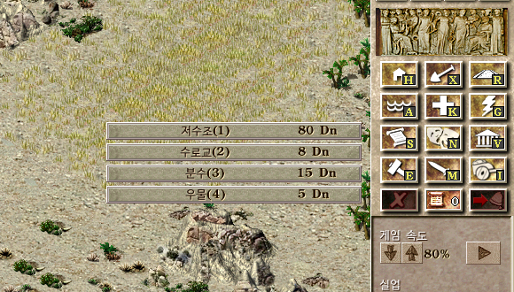
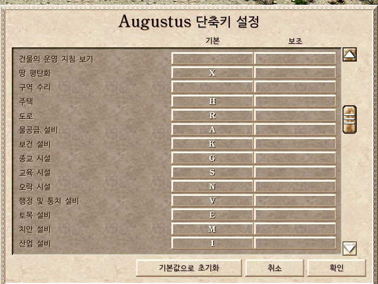

# 시저3 건설 단축키

[English](README.md) | **한국어**

**시저3(Caesar III)** 의 오픈소스 엔진 [Julius](https://github.com/bvschaik/julius)와 [Augustus](https://github.com/Keriew/augustus)에 키보드 건설 단축키를 추가한 수정판입니다.
사이드바를 클릭하지 않고 카테고리 키와 숫자만으로 모든 건물을 고를 수 있습니다.

```
A → 3        분수
G → 1 → 5    마르스 작은 신전   (Augustus 기준, Julius는 G → 1 → 4)
H            주거지
```



## 기능

- **카테고리 키**: 키 하나로 사이드바 건설 메뉴(물, 보건, 종교 …)가 열립니다.
- **숫자로 항목 선택**: 건설 메뉴가 열려 있을 때 숫자를 누르면 그 순서의 건물이 선택됩니다. 신전·농장 같은 하위 메뉴도 숫자를 이어서 누르면 됩니다.
- **메뉴 번호 표시**: 메뉴 항목마다 누를 키가 표시됩니다.
- **버튼 단축키 표시**: 사이드바 건설 버튼 오른쪽 아래에 해당 키가 표시됩니다.
- 모든 키는 게임 안 단축키 설정에서 바꿀 수 있고, 표시는 끌 수 있습니다.
- 게임 규칙은 바꾸지 않습니다.

## 어떤 걸 받아야 하나요?

두 수정판은 키 배치가 같아서 오가며 써도 다시 익힐 필요가 없습니다.

| | Julius 수정판 | Augustus 수정판 |
|---|---|---|
| 기준 엔진 | Julius 1.8.0 | Augustus `master` [`13ad05a`](https://github.com/Keriew/augustus/commit/13ad05ab4182c335e9739e1687ae6376b7229ab6) (2026-10-30) |
| 게임 내용 | 원작 시저3 그대로 | 원작 + 새 건물, 길 차단로, 기념물, 각종 편의 기능 |
| 세이브 | 원본 시저3, Julius 1.8.0과 호환 | 예전 세이브는 모두 불러올 수 있음. 새로 저장한 세이브는 이 버전 이상에서만 열림 |
| 실행 파일 | 32비트 Windows | 64비트 Windows |
| 자세한 설명 | [julius/README.ko.md](julius/README.ko.md) | [augustus/README.ko.md](augustus/README.ko.md) |

원작 그대로를 원하면 **Julius**, 길 차단로와 추가 콘텐츠를 원하면 **Augustus**를 받으세요.

## 다운로드

[**Releases**](https://github.com/1sunJ/caesar3-build-hotkeys/releases/latest) 페이지에서 최신 zip 파일을 받으세요.

| 파일 | 내용 |
|---|---|
| `julius-build-hotkeys-1.8.0.zip` | `julius.exe`, SDL2 DLL, 패치, 설명서 |
| `augustus-build-hotkeys-13ad05a.zip` | `augustus.exe`, SDL2 DLL, `assets` 폴더, 패치, 설명서 |

**시저3 원본 게임**(Steam, GOG, CD. 1.0.1.0 패치 필요, Steam·GOG판은 이미 포함)이 있어야 합니다. 이 저장소에는 게임 데이터가 들어 있지 않습니다.

한글로 플레이하려면 게임 폴더에 한글 패치가 있어야 합니다. 이미 Julius나 Augustus를 한글로 쓰고 있다면 그대로 쓰면 됩니다.

## 빠른 설치

### Julius 수정판

1. 시저3 게임 폴더를 엽니다. Steam판은 보통 아래 경로입니다.
   `C:\Program Files (x86)\Steam\steamapps\common\Caesar 3\C3`
2. 그 폴더에 `julius.exe`, `SDL2.dll`, `SDL2_mixer.dll`이 이미 있으면 백업해 둡니다.
3. zip 안의 `julius.exe`, `SDL2.dll`, `SDL2_mixer.dll`을 게임 폴더에 복사합니다.
4. `julius.exe`를 실행합니다.

### Augustus 수정판

1. 원하는 **새 폴더**에 압축을 풉니다. 다른 버전 Augustus 파일과 섞지 마세요.
2. `augustus.exe`를 실행합니다.
3. 처음 실행하면 시저3 게임 폴더(`c3.exe`가 있는 폴더)를 고릅니다.

Steam 플레이 버튼으로 실행하는 방법, 문제 해결 등 자세한 내용은 [julius/README.ko.md](julius/README.ko.md), [augustus/README.ko.md](augustus/README.ko.md)를 보세요.

## 기본 단축키

| 카테고리 | 키 | 카테고리 | 키 |
|---|---|---|---|
| 주거 | `H` | 교육 | `S` |
| 철거 | `X` | 오락 | `N` |
| 도로 | `R` | 행정 | `V` |
| 물 | `A` | 기술 | `E` |
| 보건 | `K` | 군사 | `M` |
| 종교 | `G` | 산업 | `I` |
| 길 차단로 *(Augustus만)* | `B` | | |

건설 메뉴가 열려 있을 때:

| 키 | 동작 |
|---|---|
| `1`~`9`, `0` (숫자 줄, 숫자패드) | 1~10번째 항목 선택 |
| `-`, `=` *(Augustus만)* | 11, 12번째 항목 선택 |
| 같은 카테고리 키 | 메뉴 닫기 |
| 다른 카테고리 키 | 그 메뉴로 바로 전환 |
| `Esc` / 오른쪽 클릭 | 메뉴 닫기 |

메뉴가 닫혀 있을 때 숫자키는 원래대로 조언자 화면을 엽니다.

기존 기본 키(오버레이 `W` `F` `D` `C` `T`, 일시정지 `P`, 군단 `L` 등)와 겹치지 않게 배치했습니다.
Augustus는 원래 `R`이 건물 회전, `X`가 건물 가동 중지였는데, Augustus 수정판에서는 이 둘을 `Shift`+`R`, `Shift`+`X`로 옮겼습니다.

현재 임무에서 지을 수 없는 건물은 메뉴에 나오지 않고, 번호는 보이는 항목 기준으로 매겨집니다. 항상 메뉴에 표시된 번호를 보고 누르세요.



## 언어

새로 번역할 문구를 추가하지 않았습니다. 단축키 설정의 카테고리 이름은 게임 원본의 사이드바 툴팁 문구를 그대로 쓰므로, 게임 데이터의 언어로 표시됩니다.
유일하게 추가된 설정(단축키 표시)은 Julius 수정판에서 영어·한국어로 번역되어 있고, Augustus 수정판에서는 원래 있던(모든 언어로 번역된) 설정을 그대로 씁니다.

## 소스 코드

수정한 전체 소스는 엔진별 저장소의 브랜치에 있습니다.

| 엔진 | 저장소 | 바뀐 부분 |
|---|---|---|
| Julius | [1sunJ/julius](https://github.com/1sunJ/julius) (`build-hotkeys` 브랜치, [bvschaik/julius](https://github.com/bvschaik/julius) v1.8.0 기준) | [비교](https://github.com/1sunJ/julius/compare/v1.8.0...build-hotkeys) |
| Augustus | [1sunJ/augustus](https://github.com/1sunJ/augustus) (`build-hotkeys` 브랜치, [Keriew/augustus](https://github.com/Keriew/augustus)의 Fork) | [비교](https://github.com/1sunJ/augustus/compare/13ad05a...build-hotkeys) |

## 직접 빌드하기

각 폴더에 원본 엔진 기준 패치 파일과 Windows(Visual Studio 2022 + CMake) 빌드 방법이 있습니다.

- [julius/README.ko.md#직접-빌드하기](julius/README.ko.md#직접-빌드하기)
- [augustus/README.ko.md#직접-빌드하기](augustus/README.ko.md#직접-빌드하기)

패치는 플랫폼에 상관없는 일반 `git apply` 패치라서, Linux·macOS에서도 원본 엔진의 빌드 문서대로 빌드할 수 있습니다.

## 저장소 구성

```
.
├── julius/
│   ├── patch/julius-1.8.0-build-hotkeys.patch
│   ├── README.md          영어 설명서
│   └── README.ko.md       한국어 설명서
├── augustus/
│   ├── patch/augustus-13ad05a-build-hotkeys.patch
│   ├── README.md
│   └── README.ko.md
├── docs/images/           스크린샷
└── LICENSE                GNU AGPL v3
```

## 라이선스

Julius와 Augustus는 **GNU AGPL v3** 라이선스이며, 이 패치와 이를 빌드한 실행 파일도 같은 라이선스를 따릅니다([LICENSE](LICENSE)). 실행 파일을 다시 배포할 때는 패치 파일이나 수정한 소스를 함께 제공해 주세요.
SDL2, SDL2_mixer는 zlib 라이선스이고, Augustus의 `assets` 폴더는 `assets/LICENSE`를 따릅니다.

시저3의 권리는 Impressions Games / Sierra에 있습니다. 이 저장소에는 게임 데이터가 없으니 게임을 정식으로 구입해서 사용하세요.

비공식 수정판입니다. 문제가 생기면 Julius나 Augustus 개발팀이 아니라 이 저장소의 Issues에 남겨 주세요.
