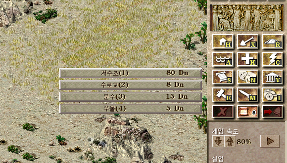
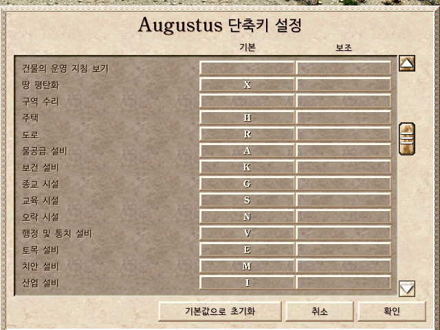

# Caesar III Build Hotkeys

**English** | [한국어](README.ko.md)

Keyboard build hotkeys for **Caesar III**, as mods for the open-source engines [Julius](https://github.com/bvschaik/julius) and [Augustus](https://github.com/Keriew/augustus).
Pick any building without touching the sidebar: press a category key, then the item's number.

```
A → 3        Fountain
G → 1 → 5    Small temple of Mars   (Augustus; G → 1 → 4 in Julius)
H            Housing
```



## Features

- **Category keys** open the sidebar build menus (water, health, religion, …) with a single key.
- **Number keys** pick an item while a build menu is open. Submenus such as temples or farms work the same way: just keep typing numbers.
- **Menu numbers**: each menu item shows the key that selects it.
- **Sidebar labels**: every build button shows its key in the bottom-right corner.
- Every key can be changed in the game's hotkey settings, and the labels can be switched off.
- No gameplay changes.

## Which one should I use?

Both mods use the same key layout, so you can switch between them without relearning anything.

| | Julius mod | Augustus mod |
|---|---|---|
| Base engine | Julius 1.8.0 | Augustus `master` @ [`13ad05a`](https://github.com/Keriew/augustus/commit/13ad05ab4182c335e9739e1687ae6376b7229ab6) (2026-10-30) |
| Gameplay | Original Caesar III | Original plus new buildings, roadblocks, monuments and many quality-of-life features |
| Saves | Compatible with original Caesar III and Julius 1.8.0 | Loads any older save; new saves need this Augustus version or newer |
| Build | 32-bit Windows | 64-bit Windows |
| Details | [julius/README.md](julius/README.md) | [augustus/README.md](augustus/README.md) |

If you want the original game exactly as it was, use **Julius**. If you want roadblocks and the extra content, use **Augustus**.

## Download

Get the latest zip from the [**Releases**](https://github.com/1sunJ/caesar3-build-hotkeys/releases/latest) page.

| File | Contents |
|---|---|
| `julius-build-hotkeys-1.8.0.zip` | `julius.exe`, SDL2 DLLs, patch, README |
| `augustus-build-hotkeys-13ad05a.zip` | `augustus.exe`, SDL2 DLLs, `assets` folder, patch, README |

You need your own copy of **Caesar III** (Steam, GOG or CD, with the 1.0.1.0 patch, which the Steam and GOG versions already include). No game data is included here.

## Quick install

### Julius mod

1. Open your Caesar III folder. On Steam this is usually
   `C:\Program Files (x86)\Steam\steamapps\common\Caesar 3\C3`
2. Back up any existing `julius.exe`, `SDL2.dll` and `SDL2_mixer.dll` there.
3. Copy `julius.exe`, `SDL2.dll` and `SDL2_mixer.dll` from the zip into that folder.
4. Run `julius.exe`.

### Augustus mod

1. Unzip to any **new** folder. Don't mix it with another Augustus version's files.
2. Run `augustus.exe`.
3. On first launch, choose your Caesar III folder (the one containing `c3.exe`).

The full guides, including running from Steam's Play button and troubleshooting, are in [julius/README.md](julius/README.md) and [augustus/README.md](augustus/README.md).

## Default hotkeys

| Category | Key | Category | Key |
|---|---|---|---|
| Housing | `H` | Education | `S` |
| Clear land | `X` | Entertainment | `N` |
| Road | `R` | Administration | `V` |
| Water | `A` | Engineering | `E` |
| Health | `K` | Military | `M` |
| Religion | `G` | Industry | `I` |
| Roadblock *(Augustus only)* | `B` | | |

While a build menu is open:

| Key | Action |
|---|---|
| `1`–`9`, `0` (number row or numpad) | Pick the 1st–10th item |
| `-`, `=` *(Augustus only)* | Pick the 11th and 12th item |
| Same category key | Close the menu |
| Another category key | Switch to that menu |
| `Esc` / right click | Close the menu |

When no menu is open, the number keys open the advisors as usual.

The keys were chosen to stay clear of the existing defaults (overlays `W` `F` `D` `C` `T`, pause `P`, legions `L`, …).
Augustus already used `R` for *rotate building* and `X` for *mothball building*. In the Augustus mod these move to `Shift`+`R` and `Shift`+`X`.
In Augustus, clear land and road have their own menus (repair area, highway, roadblock), so `X` and `R` open them like the other categories: clear land is `X` → `1`, road is `R` → `1`. In Julius they select the tool directly.

Menu items that the current mission doesn't allow are hidden, and the numbers count only the visible items. Always go by the number shown in the menu.



## Languages

The mods add no new text to translate. The category names in the hotkey settings come from the game's own sidebar tooltips, so they appear in whatever language your Caesar III data is in.
The one new option (*show hotkeys*) is translated into English and Korean in the Julius mod, and uses Augustus's existing, fully translated option in the Augustus mod.

## Source code

The full modified source is on GitHub, one branch per engine:

| Engine | Repository | Changes |
|---|---|---|
| Julius | [1sunJ/julius](https://github.com/1sunJ/julius) (branch `build-hotkeys`, based on [bvschaik/julius](https://github.com/bvschaik/julius) v1.8.0) | [compare](https://github.com/1sunJ/julius/compare/v1.8.0...build-hotkeys) |
| Augustus | [1sunJ/augustus](https://github.com/1sunJ/augustus) (branch `build-hotkeys`, fork of [Keriew/augustus](https://github.com/Keriew/augustus)) | [compare](https://github.com/1sunJ/augustus/compare/13ad05a...build-hotkeys) |

## Building from source

Each folder contains a patch against the upstream engine and step-by-step build instructions for Windows (Visual Studio 2022 + CMake):

- [julius/README.md#building-from-source](julius/README.md#building-from-source)
- [augustus/README.md#building-from-source](augustus/README.md#building-from-source)

The patches are plain `git apply` patches with no platform-specific code, so Linux and macOS builds follow the upstream build guides.

## Repository layout

```
.
├── julius/
│   ├── patch/julius-1.8.0-build-hotkeys.patch
│   ├── README.md          English guide
│   └── README.ko.md       Korean guide
├── augustus/
│   ├── patch/augustus-13ad05a-build-hotkeys.patch
│   ├── README.md
│   └── README.ko.md
├── docs/images/           Screenshots
└── LICENSE                GNU AGPL v3
```

## License

Julius and Augustus are licensed under the **GNU AGPL v3**, and so are these patches and the binaries built from them ([LICENSE](LICENSE)). If you redistribute the binaries, include the patch file or the modified source.
SDL2 and SDL2_mixer are under the zlib license. Augustus's `assets` folder is covered by its own `assets/LICENSE`.

Caesar III is © Impressions Games / Sierra. This project contains no game data. Please buy the game.

These are unofficial mods. Please don't report problems with them to the Julius or Augustus developers; open an issue here instead.
